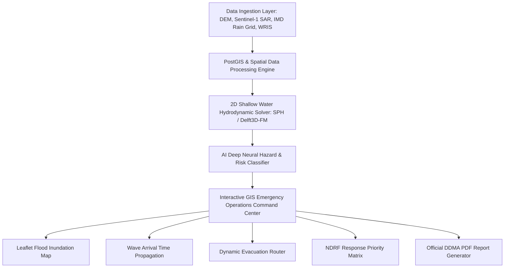

# 🌊 FloodTwin – AI-Based Dam Break Digital Twin

[](https://sih.gov.in)
[](https://reactjs.org/)
[](https://www.typescriptlang.org/)
[](https://tailwindcss.com/)
[](https://leafletjs.org/)
[]()

> **Smart India Hackathon Problem Statement**: *Dam Break Inundation Modelling Using Hydrodynamic Modelling of any River*

**FloodTwin** is a modern, government-grade disaster-management decision-support platform designed for disaster response authorities (NDMA, SDMA, DDMA), Central Water Commission (CWC) engineers, and field officers. It simulates dam-break scenarios, predicts flood inundation extent, identifies high-risk downstream villages and critical infrastructure, estimates wave arrival times, and plans dynamic evacuation routes.

---

## 🏛️ System Architecture



---

## 🌟 Key Features

1. **EOC Command Dashboard**: Executive high-level KPI cards, real-time CAP dispatch alerts ticker, and central GIS map preview.
2. **Interactive GIS Flood Map**: Leaflet map centered over Tehri Dam / Bhagirathi-Ganga basin (with presets for Hirakud and Sardar Sarovar). Toggles for Flood Extent, Water Depth Heatmap, Velocity Fields, Arrival Contours, Villages, Hospitals, and Shelters.
3. **Hydrodynamic Dam-Break Simulator**: Real-time parameter controls for water stage level, storage volume, breach geometry width/depth, formation time, release discharge, and rainfall. Solves 2D hydrodynamic outflow wave equations dynamically.
4. **What-If Scenario Comparison**: Multi-scenario comparison matrix (Piping Failure vs Overtopping vs Catastrophic Collapse) with comparative Recharts analytics.
5. **AI Hazard Assessment Engine**: Deep neural risk classifier assigning composite hazard indices (0 - 100) and generating prioritized response directives.
6. **Flood Arrival Lead Time Prediction**: Downstream wave front propagation timeline tracking arrival counts at downstream milestones (Dam → Shivpuri → Devprayag → Rishikesh → Haridwar).
7. **Dynamic Evacuation Path Router**: Computes primary safe evacuation paths avoiding submerged road segments and assigns target relief shelters.
8. **Critical Infrastructure Inventory**: Searchable directory of hospitals, bridges, power plants, and shelters with submersion status.
9. **Sentinel-1 SAR Satellite Change Detection**: Interactive pre-flood baseline vs post-flood SAR water mask comparison slider.
10. **Official DDMA Report Export**: Formal government letterhead PDF export modal with signature approval blocks.

---

## 🛠️ Tech Stack

- **Frontend**: React 18, TypeScript, Vite
- **Styling**: Tailwind CSS, Lucide Icons, Custom EOC Theme
- **GIS Mapping**: Leaflet, React-Leaflet, OpenStreetMap CartoDB Dark
- **Charts & Data Viz**: Recharts, Canvas Confetti
- **Hydro Solvers**: SPH & Delft3D-FM 2D Shallow Water wave formulations

---

## 🚀 Quick Start & Installation

```bash
# 1. Clone the repository
git clone https://github.com/YOUR_USERNAME/FloodTwin.git

# 2. Change into directory
cd FloodTwin

# 3. Install dependencies
npm install

# 4. Start local development server
npm run dev
```

Open `http://localhost:3000` in your web browser.

---

## 📄 License & Disclaimer

*This is a functional prototype built for Smart India Hackathon presentation purposes using realistic mock datasets and simulated outputs clearly labeled as DEMO DATA.*
